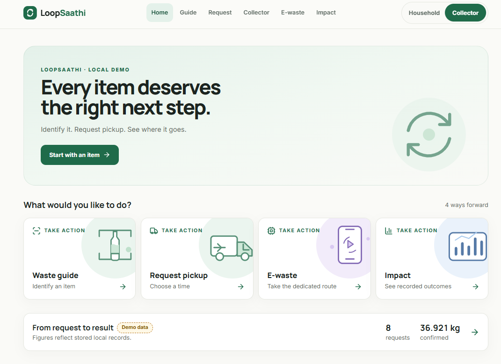
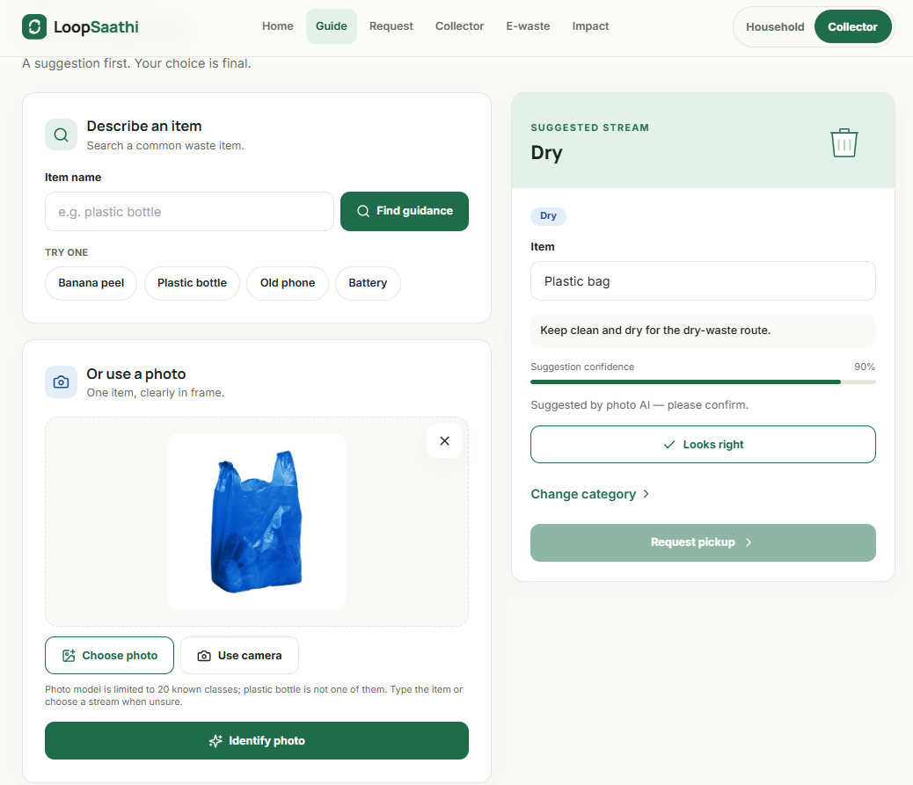
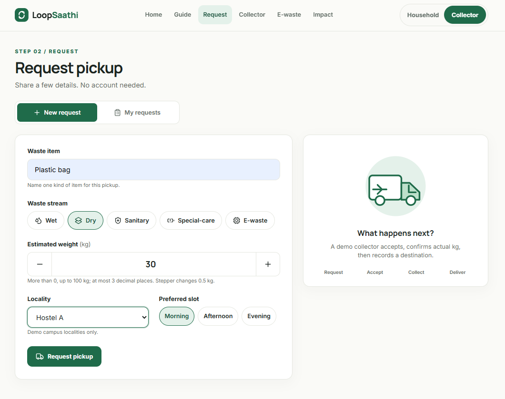
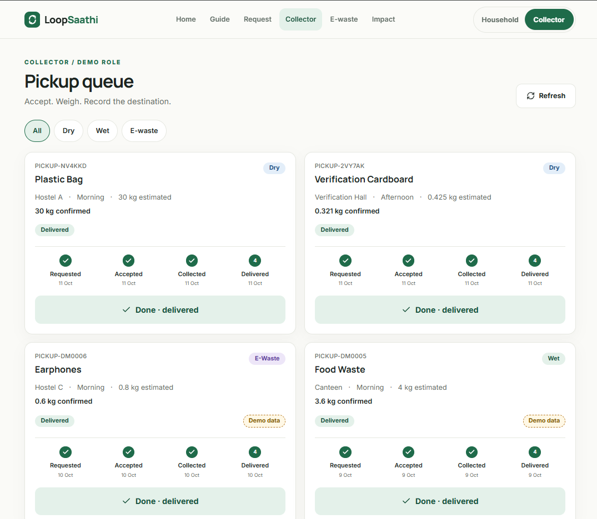
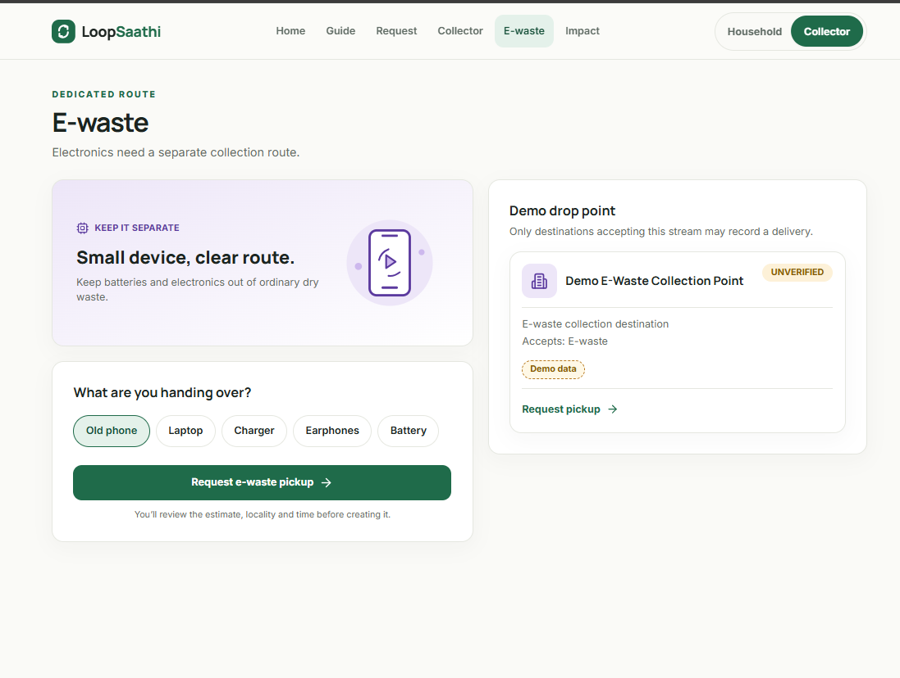
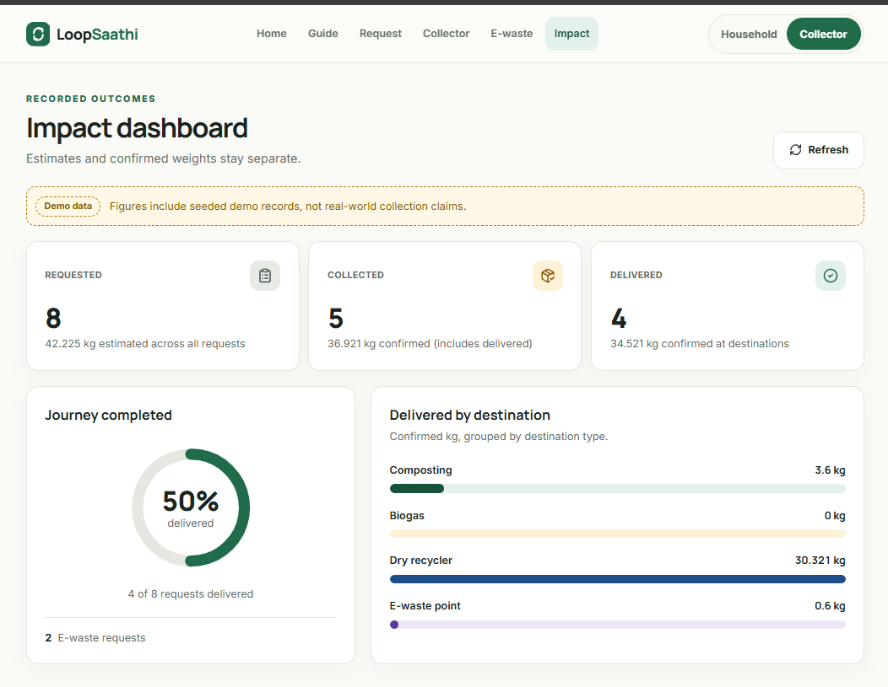
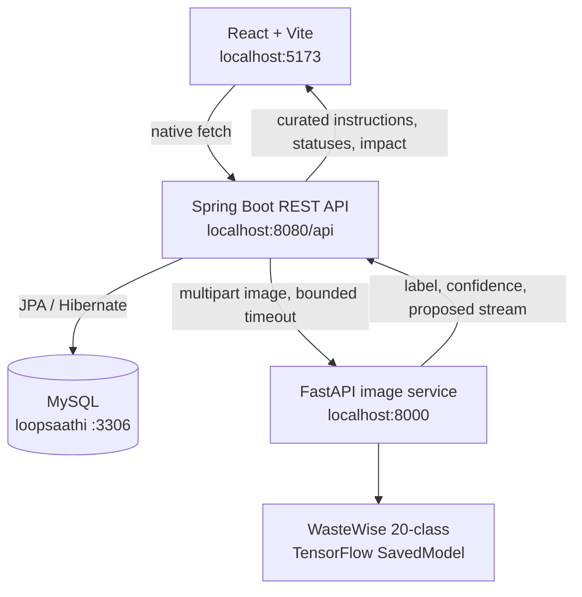
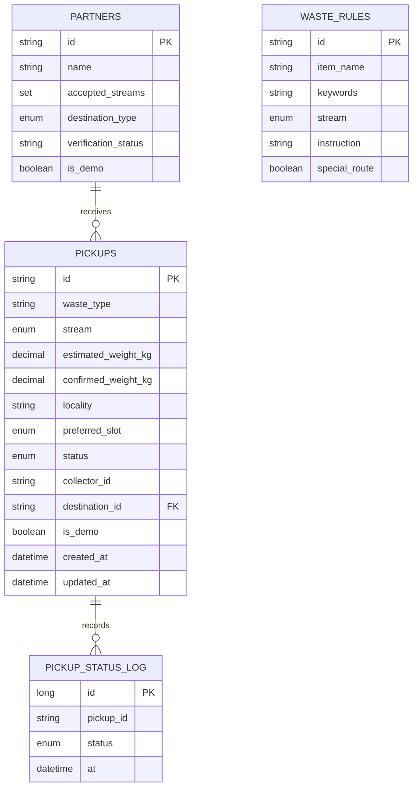

# LoopSaathi

### Every item deserves the right next step.

LoopSaathi is a local-first waste coordination prototype that connects one everyday waste action to a recorded outcome:

> **Identify waste → request pickup → collector accepts → confirm actual weight → record destination → update impact**

It is designed for a household or hostel resident, a waste collector, and a viewer of the impact dashboard. There is no login and no cloud dependency: the role switcher changes the demo view, while Spring Boot remains the single API used by the browser.

<p align="center">
  
</p>

## Highlights

- **Waste Guide** — search an item, upload a photo, review the suggested stream, or correct it manually.
- **Five waste streams** — Wet, Dry, Sanitary, Special-care, and dedicated E-waste.
- **Pickup lifecycle** — `REQUESTED → ACCEPTED → COLLECTED → DELIVERED` with a traceable status log.
- **Collector workflow** — accept a pickup, enter the confirmed measured kg, and select an eligible destination.
- **Impact dashboard** — separates requested estimates, confirmed collected kg, and delivered kg.
- **Honest demo data** — seeded records and destinations are visibly marked `Demo data`; destinations are `UNVERIFIED`.
- **AI fallback** — text/manual classification and pickup creation continue to work when the Python service is offline.
- **Real local photo model** — the copied WasteWise 20-class TensorFlow SavedModel handles supported image classes.

## Product flow

```mermaid
flowchart LR
    A[Resident identifies item] --> B{Text or photo?}
    B -->|Text| C[Spring matches waste rule]
    B -->|Photo| D[FastAPI predicts label]
    D --> E[Spring validates label and rule]
    C --> F[Resident reviews or changes stream]
    E --> F
    F --> G[Create pickup]
    G --> H[REQUESTED]
    H --> I[Collector accepts]
    I --> J[ACCEPTED]
    J --> K[Collector confirms actual kg]
    K --> L[COLLECTED]
    L --> M[Collector records eligible destination]
    M --> N[DELIVERED]
    N --> O[Impact recalculates from MySQL]
```



## Screenshots

| Home | Waste Guide |
|---|---|
|  |  |

| Request Pickup | Collector queue |
|---|---|
|  |  |

| E-waste route | Impact dashboard |
|---|---|
|  |  |

## Architecture



### Ownership boundaries

| Layer | Owns | Does not own |
|---|---|---|
| React frontend | Screens, role switcher, loading/error states, manual correction, responsive UI | Database writes, impact math, AI truth, direct FastAPI calls |
| Spring Boot | REST contract, validation, status rules, MySQL persistence, curated waste instructions, impact math, CORS | Model training, frontend state, authentication |
| FastAPI | Image upload validation, SavedModel loading, image label/confidence, label-to-stream proposal | Pickups, MySQL, instructions, destination eligibility |
| MySQL | Pickups, status logs, partners, waste rules, timestamps | UI presentation and model inference |

## Technology stack

| Area | Technology | Version / property |
|---|---|---|
| Frontend runtime | React + Vite | JavaScript/JSX; Vite dev server on `5173` |
| Frontend routing | React Router | Browser routes: `/`, `/guide`, `/request`, `/collector`, `/ewaste`, `/impact` |
| Styling | Tailwind CSS | Pinned v3; custom CSS tokens for the LoopSaathi visual system |
| Icons | lucide-react | Small interface icons; larger artwork is inline SVG |
| Fonts | Manrope + Inter | Local `@fontsource-variable` packages; works offline |
| API | Spring Boot | 3.5.6, Java 21, Maven |
| Persistence | Spring Data JPA + Hibernate | `spring.jpa.hibernate.ddl-auto=update` |
| Database | MySQL | Database `loopsaathi`, local port `3306` |
| Image API | FastAPI + Uvicorn | Python 3.13, local port `8000` |
| Image model | TensorFlow SavedModel | WasteWise 20-class model; no training in this project |
| HTTP client | Native browser `fetch` | Frontend calls only `http://localhost:8080/api` |

## Project properties

| Property | Value / meaning |
|---|---|
| Run mode | Local only; no deployment, cloud, Docker, or Kubernetes |
| Frontend URL | `http://localhost:5173` |
| Spring API URL | `http://localhost:8080/api` |
| AI health URL | `http://localhost:8000/health` |
| AI classify URL | `http://localhost:8000/classify` |
| Database URL | `jdbc:mysql://localhost:3306/loopsaathi?createDatabaseIfNotExist=true&useSSL=false&allowPublicKeyRetrieval=true&serverTimezone=Asia/Kolkata` |
| Database user | Local `root` account by default |
| Database password | Local-only; use ignored `app/backend/application-local.properties` or `SPRING_DATASOURCE_PASSWORD` |
| CORS origin | `http://localhost:5173` |
| Max image upload | 10 MB |
| Image confidence threshold | Below `0.6` becomes `needsReview: true` |
| Pickup ID format | `PICKUP-` plus six uppercase alphanumeric characters |
| Weight rule | Numeric, greater than `0`, at most `100`, maximum three decimals |
| Demo destination rule | Destination must accept the pickup stream; otherwise delivery is rejected |

## Data model



## API overview

All browser-facing endpoints are served by Spring under `/api`.

| Method | Endpoint | Purpose |
|---|---|---|
| `POST` | `/api/classify` | Classify text or an uploaded image; returns a reviewable suggestion |
| `GET` | `/api/waste-items?search=` | Search curated item rules and suggestions |
| `GET` | `/api/pickups?status=&stream=` | List persisted pickups and status timelines |
| `POST` | `/api/pickups` | Create a `REQUESTED` pickup |
| `PATCH` | `/api/pickups/{id}/accept` | Move `REQUESTED` → `ACCEPTED` |
| `PATCH` | `/api/pickups/{id}/collect` | Add confirmed kg and move `ACCEPTED` → `COLLECTED` |
| `PATCH` | `/api/pickups/{id}/deliver` | Validate destination and move `COLLECTED` → `DELIVERED` |
| `GET` | `/api/partners?stream=` | List destinations accepting a stream |
| `GET` | `/api/impact` | Calculate dashboard metrics from stored rows |

### Impact rules

- **Requested** = estimated kg across all pickups.
- **Collected** = confirmed kg for `COLLECTED` and `DELIVERED` pickups.
- **Delivered** = confirmed kg for `DELIVERED` pickups, grouped by destination type.
- **Completion rate** = delivered pickups ÷ total pickups.
- No CO₂, energy, money, reward, or other invented metric is shown.

## AI behavior and honesty rules

The model is a suggestion, not an authority.

1. Text classification uses the MySQL `waste_rules` table.
2. Photo classification goes through Spring to the local FastAPI service.
3. Spring maps the model label back to a curated waste rule.
4. Instructions are always taken from the curated rule, never from raw model output.
5. Unknown labels, low confidence, mixed items, special-care uncertainty, timeout, or AI downtime require manual review.
6. The WasteWise model covers 20 classes and does not include a plastic-bottle class; plastic bottles are still fully supported through text/manual selection.
7. Batteries use `SPECIAL_CARE`; phones, laptops, chargers and earphones use dedicated `E_WASTE`.

## Quick start on Windows

### Prerequisites

- Java 21 and Maven 3.9+
- Node.js and npm
- Python 3.13 available as `py -3.13`
- MySQL running on `localhost:3306`

### Configure local MySQL password

Create this ignored file once:

```powershell
Set-Content -LiteralPath .\app\backend\application-local.properties `
  -Value 'spring.datasource.password=<your-local-mysql-password>'
```

### Start everything

```powershell
.\app\start-all.bat
```

The batch file opens three PowerShell windows for Spring Boot, FastAPI and Vite. MySQL must already be running.

### Start manually

```powershell
cd D:\Loopsathi\app\backend
mvn spring-boot:run
```

```powershell
cd D:\Loopsathi\app\ai-service
py -3.13 -m venv .venv
.\.venv\Scripts\python.exe -m pip install -r requirements.txt
.\.venv\Scripts\python.exe -m uvicorn main:app --host 127.0.0.1 --port 8000
```

```powershell
cd D:\Loopsathi\app\frontend
npm install
npm run dev -- --host 127.0.0.1 --port 5173
```

Open <http://localhost:5173>.

## Two-minute demo

1. Open **Waste Guide** and search `banana peel`.
2. Review the Wet suggestion, or upload a supported photo and confirm the proposed stream.
3. Choose **Request pickup**, enter an estimated kg, locality and preferred slot, then save the generated `PICKUP-XXXXXX` ID.
4. Switch to **Collector**, accept the request, enter the actual measured kg, and record a compatible destination.
5. Open **Impact** to see Requested (estimated), Collected (confirmed), and Delivered totals separately.
6. Open **E-waste** to see the dedicated route. Battery requests use `SPECIAL_CARE` and intentionally have no seeded destination in this prototype.
7. Stop FastAPI and repeat text/manual classification to verify that the core pickup flow still works without image AI.

## Verification

Run the project checks from their respective folders:

```powershell
cd D:\Loopsathi\app\backend
mvn -q package
```

```powershell
cd D:\Loopsathi\app\frontend
npm run build
```

```powershell
cd D:\Loopsathi\app\ai-service
py -3.13 -m py_compile main.py classifier.py translator.py
```

The verified local checks cover:

- MySQL connection, schema creation and idempotent seed data
- Text classification and curated instructions
- Real banana-peel photo inference through Spring → FastAPI → SavedModel
- Create → accept → collect → deliver
- Invalid transitions returning `409`
- Bad weights returning `400`
- Ineligible destinations being rejected
- Impact totals being calculated from persisted records
- Frontend production build and all six Vite route URLs

## Reference implementations used

The reference repositories remain read-only under `D:\Loopsathi\githubrepos\`. Adapted blocks have `Source:` comments in the implementation.

| Reference | What was reused or learned |
|---|---|
| `TrashTag-main` | Request form state, pickup cards, status actions, sheets, toasts and empty states. Supabase, maps, chat, payments, auth and live tracking were removed. |
| `wt23-wastewise-main` | WasteWise 20-class SavedModel, label order, preprocessing evidence and class-to-stream translation patterns. |
| `WasteSegregationUsingAI-main` | Upload, preview and camera interaction patterns. Its local TensorFlow.js weight shards were incomplete, so the Python SavedModel path was selected. |
| `EcoFind-main` | E-waste category and destination-card layout ideas. Real facilities, contact details, maps, pricing and verified claims were not copied. |
| `serverless-master` | README-level CRUD/API architecture review only; no reusable Java source was present locally. |
| `aws-plaid-demo-app-main` | Architecture review only; finance, AWS, authentication and cloud infrastructure are out of scope. |

## Repository map

```text
D:\Loopsathi\
├─ README.md                         # This GitHub project overview
├─ docs\
│  ├─ PRD.md                         # Product requirements and demo story
│  ├─ Architecture.md                # Runtime, schema, API and Repo Map
│  ├─ Design.md                      # Visual system and accessibility rules
│  ├─ Rules.md                       # Contributor and AI-assistant rules
│  ├─ Phases.md                      # Build phases and completion checks
│  ├─ Memory.md                      # Current decisions, evidence and gaps
│  └─ screenshots\                   # UI screenshots shown above
└─ app\
   ├─ frontend\                     # React/Vite/Tailwind client
   ├─ backend\                      # Spring Boot/MySQL API
   ├─ ai-service\                   # FastAPI/TensorFlow image service
   ├─ start-all.bat                 # Windows three-process launcher
   └─ README.md                      # Detailed local runbook and PowerShell checks
```

## Scope and limitations

This is intentionally a small local prototype. It does **not** include authentication, cloud deployment, maps, chat, notifications, payments, rewards, route optimization, real partner data, Docker/Kubernetes, CO₂ claims, energy figures, or money/revenue metrics.

Known limitations:

- No authentication means “My requests” shows local records rather than user-owned records.
- Photo recognition is limited to the 20 classes included in the WasteWise model.
- The model does not contain a plastic-bottle class; use text/manual classification for plastic bottles.
- Special-care currently has no seeded destination, so collection can be recorded but delivery remains blocked.
- All partners and seeded rows are fictional demo records and are visibly marked `Demo data` / `UNVERIFIED`.

## Documentation

- [Product requirements](docs/PRD.md)
- [Architecture and API contract](docs/Architecture.md)
- [Design system](docs/Design.md)
- [Contributor rules](docs/Rules.md)
- [Build phases](docs/Phases.md)
- [Current project memory](docs/Memory.md)
- [Detailed local runbook](app/README.md)

## License / project status

LoopSaathi is a local prototype created for demonstration and development. It is not an operational waste collection service, and its fictional destinations should not be interpreted as real facilities or partnerships.
